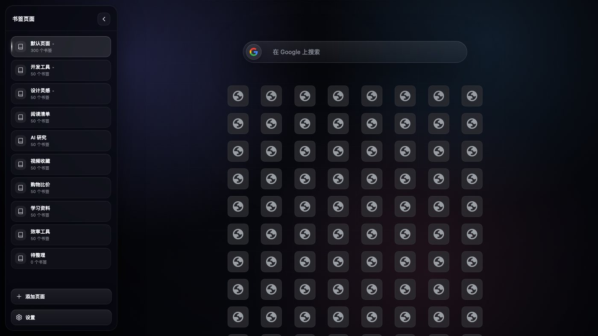
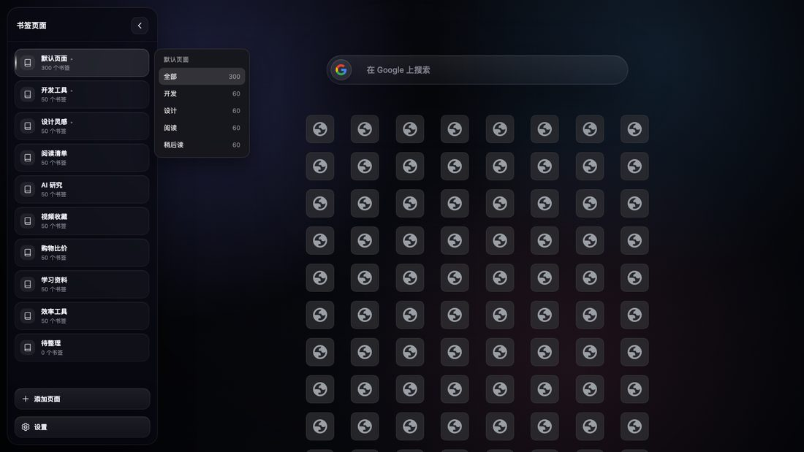
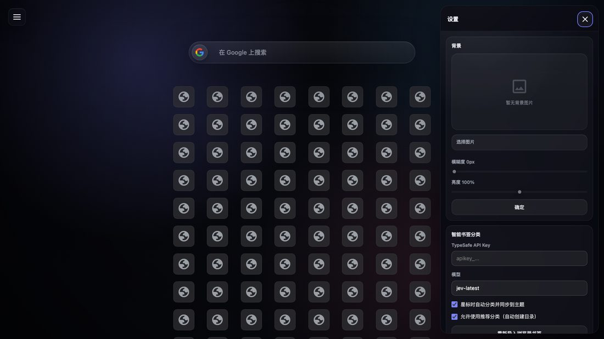
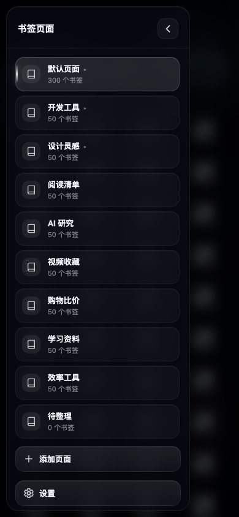
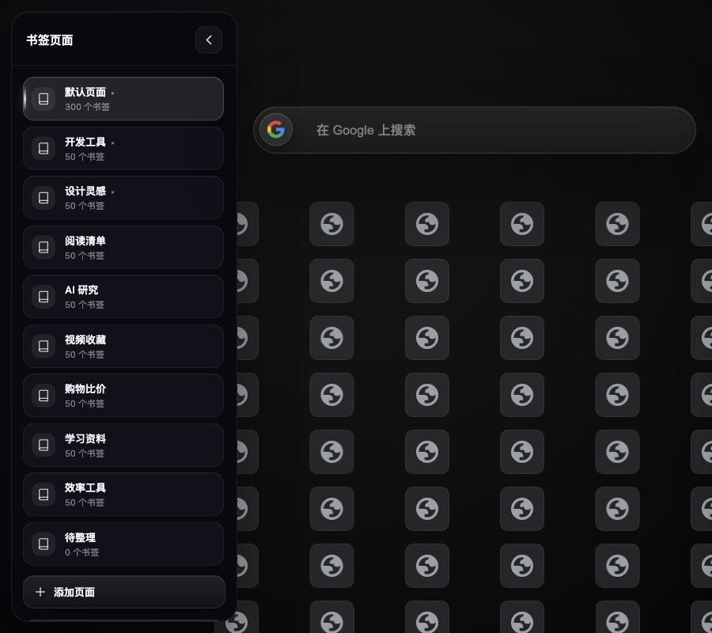
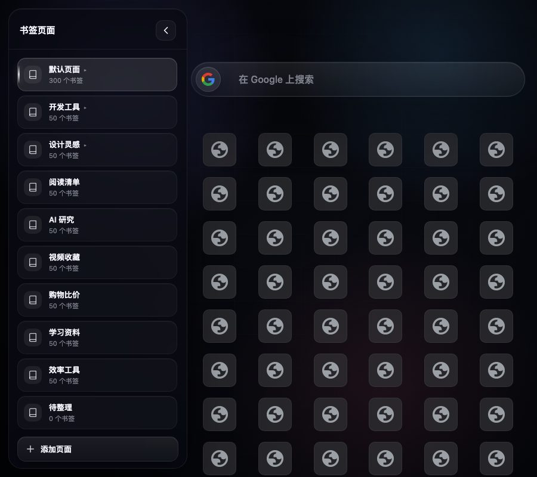

<div align="center">
  
  <h1>Chrome 优雅新标签页</h1>
  <p>🌟 一个简洁、优雅且功能强大的 Chrome 新标签页扩展 🌟</p>
  
  <p>Google浏览器主页</p>
</div>

<p align="center">
  
  
  
  
  
</p>

<div align="center">

</div>

## 🌈 界面预览

<div align="center">
  
  <p align="center">v2.0 主界面 · 侧栏一级分类 + 悬停二级分类 + 书签网格（300 条/页实测）</p>
</div>

<div align="center">
  <table>
    <tr>
      <td align="center">
        <br/>
        <sub>🧠 二级分类悬浮面板（视口内 clamp）</sub>
      </td>
      <td align="center">
        <br/>
        <sub>⚙️ 设置面板（固定头 + 独立滚动）</sub>
      </td>
    </tr>
    <tr>
      <td align="center">
        <br/>
        <sub>📱 移动端抽屉（390×844）</sub>
      </td>
      <td align="center">
        <br/>
        <sub>v1.9：900px 视口下网格越界 / 被侧栏遮挡</sub><br/>
        <br/>
        <sub>v2.0：排版修复后（无越界 / 无遮挡）</sub>
      </td>
    </tr>
  </table>
</div>

## ✨ 核心特性

- 📚 **多页面书签管理** - 在侧边栏创建、重命名、删除与切换不同书签页，独立管理收藏
  - 页面切换 keyed diff + 按帧增量渲染，图标立即更新
  - 书签优雅淡入动画，错落有致的视觉效果
- 🧠 **智能书签分类** - 与浏览器书签栏双向同步：一级目录 → 侧栏页面，二级目录 → 页面内分类
  - 浏览器星标 → 自动分类（TypeSafe 模型 + 离线域名规则兜底）并镜像到主题
  - 主题里粘贴/拖入网址 → 同时写入浏览器书签与当前分类
- 🚀 **v2.0 架构与性能** - ESM 分层 + 单一数据源；300 条/页下单条更新 23ms、滚动 p95 19ms；排版问题 P0/P1 清零（见 [docs/ARCHITECTURE.md](docs/ARCHITECTURE.md)）
- 🎯 **智能搜索与快捷键** - 下拉选择搜索引擎，支持 `Alt+数字` 快速切换，一键直达
  - 搜索引擎切换流畅动画，图标平滑过渡
  - 支持 8 种主流搜索引擎，图标显示优化
- 📋 **粘贴即添加** - 在页面直接粘贴网址，自动获取标题与图标，并可编辑名称后保存
- 🧩 **图标本地化** - 使用 Chrome 内置 `_favicon` 接口同步生成站点图标，零公网请求、零网络等待
  - 按域名缓存，失败/非法 URL 回退到字母图标
  - 不再把 base64 塞进 localStorage（旧实现会撑爆 5MB 配额）
- 🧭 **拖拽排序与交互优化** - 平滑拖拽、悬浮与交换动画，支持批量移动与就地保存
- 🎨 **个性化背景** - 上传背景图片，实时预览与模糊/亮度调节，动画过渡更顺滑
- 💾 **配置备份与恢复** - 一键导出/导入包含设置、书签页与书签的数据，便捷迁移
- 🔒 **Manifest V3 与权限控制** - 合理使用 `storage`、`scripting` 等权限，确保安全与性能
- ✨ **流畅动画体验** - GPU 加速动画，优化性能，提供丝滑的用户体验
- 🔮 **玻璃态深色主题** - 毛玻璃质感的暗色 UI，现代化视觉风格

## 🔍 搜索引擎支持

<div align="center">
  <table>
    <tr>
      <td align="center">
        <br/>
        <sub><b>Google</b></sub>
      </td>
      <td align="center">
        <br/>
        <sub><b>百度</b></sub>
      </td>
      <td align="center">
        <br/>
        <sub><b>哔哩哔哩</b></sub>
      </td>
      <td align="center">
        <br/>
        <sub><b>必应</b></sub>
      </td>
    </tr>
    <tr>
      <td align="center">
        <br/>
        <sub><b>DuckDuckGo</b></sub>
      </td>
      <td align="center">
        <br/>
        <sub><b>GitHub</b></sub>
      </td>
      <td align="center">
        <br/>
        <sub><b>Yahoo</b></sub>
      </td>
      <td align="center">
        <br/>
        <sub><b>Ecosia</b></sub>
      </td>
    </tr>
  </table>
</div>

## 🚀 快速开始

### 安装方式

 **开发者模式安装**
   - 下载本仓库代码
   - 打开 Chrome 扩展程序页面 (`chrome://extensions/`)
   - 开启"开发者模式"
   - 点击"加载已解压的扩展程序"
   - 选择代码目录即可

> **从 v1.x 升级到 v2.0**：覆盖代码后在 `chrome://extensions` 点「重新加载」即可。storage key 与 v1.x 完全一致，已有页面、书签、设置、API Key 全部保留，无需重新导入。

### 使用说明

1. **打开新标签页** - 自动加载默认页面和书签
2. **管理书签页面** - 点击左侧侧边栏创建、切换或管理多个书签页面
3. **添加书签** - 复制网址并粘贴到页面任意位置，自动获取标题和图标
4. **编辑书签** - 右键图标可以编辑名称或删除
5. **拖拽排序** - 拖拽图标可以调整顺序，支持跨行移动
6. **切换搜索引擎** - 点击搜索框左侧图标选择搜索引擎
7. **个性化设置** - 点击左上角设置图标，可自定义背景、模糊度与亮度
8. **备份恢复** - 在设置面板中导出/导入配置，方便迁移数据

## 🎬 动画特性

- **页面切换动画** - 点击页面图标立即切换，书签优雅淡入显示
- **搜索引擎切换** - 图标平滑淡入淡出，带轻微缩放效果
- **拖拽交互** - 流畅的拖拽动画，实时预览位置
- **悬浮效果** - 图标悬浮时平滑放大，提供视觉反馈
- **GPU 加速** - 使用 `will-change` 和 `transform3d` 优化性能

## 🔧 技术特性（v2.0 架构）

- **ES Modules 分层**：`core`（config/utils/dom/storage/store）→ `features`（分类/同步/设置/导入导出）→ `ui`（侧栏/网格/搜索/设置/弹窗/粘贴）→ `main.js`，只有一个模块入口，无全局脚本顺序依赖
- **单一数据源 + 单向数据流**：`core/store.js` 是唯一运行时状态，DOM 不再作为保存来源；所有写入走串行队列、同 key 合并
- **按区域增量渲染**：侧栏页面列表 keyed diff、书签网格纯增删复用 DOM、事件全部委托到容器
- **CSS 单层化**：`ui.css`（3241 行 / 3 段追加覆盖）拆成 8 个分层文件共 2384 行，`!important` 只保留在 `perf.css`（32 处），z-index 全部令牌化
- **module service worker**：background 与页面共用同一份 features 实现
- **后台无头验证**：`tools/` 内 CDP 审计/性能/功能回归脚本，默认 `--headless=new`，不弹窗

## 📁 项目结构（v2.0）

```text
src/
├── index.html              # 8 个分层 CSS + 15 个 modulepreload + 单 module 入口
├── css/                    # base / layout / search / sidebar / squares / settings / overlays / perf
├── js/
│   ├── boot-state.js       # 唯一同步脚本：首帧前预置侧栏布局（启动 CLS=0）
│   ├── main.js             # 启动器：store.init → 应用主题 → 按优先级 mount UI
│   ├── core/               # config / utils / dom / storage / store（单一数据源）
│   ├── features/           # classifier / bookmark-sync / settings / import-export
│   └── ui/                 # frame / dialogs / flyout / sidebar / squares / search / settings-panel / paste
└── background.js           # ESM module service worker（首次导入 / 星标分类 / 域名缓存）
tests/run-tests.mjs         # 64 项单元测试（原 23 项 + store/background/静态检查）
tools/                      # headless CDP：布局审计 / 性能 / 功能回归 / 前后对比
docs/                       # 架构与验收报告（见文末「文档导航」）
```

## 🧪 开发与验证

```bash
node tests/run-tests.mjs                 # 64 项单元测试
node tools/functional-regression.mjs     # 真实 Chrome 功能回归（12 项）
node tools/audit.mjs --ext . --out audit/after --label after       # 73 个「视口×状态」布局审计
node tools/perf-audit.mjs --ext . --out audit/after/perf.json --label after
node tools/compare.mjs --before audit/before --after audit/after   # 自动前后对比表
```

> 浏览器验证默认 `--headless=new` 后台运行、不弹窗；审计产物在 `audit/`（本地生成，已 gitignore），结论报告在 `docs/`。

## 📈 浏览量

<div align="center">
  
</div>


---

## 🧠 智能书签分类（融合版）

本仓库现在是**「新标签页 + 书签智能分类」二合一扩展**，不再需要单独的「智能书签助手」。

### 首次使用：按浏览器书签建分类

加载扩展后打开新标签页，background 会读取浏览器「书签栏」：

- **一级目录 → 主题左侧分类页**（也就是侧边栏的「书签页面」）
- **二级目录 → 页面内书签的二级分类**（鼠标悬浮一级分类时弹出）
- 书签栏根目录下的零散书签 → 「未分类」页面
- 已导入过不会重复导入；设置里可「重新导入浏览器书签」

### 收藏时双份保存

- **主题里粘贴网址**：保存到当前分类页 + 当前二级分类，同时在浏览器书签对应目录创建一条书签
- **浏览器里点星标**（收藏到书签栏根目录）：background 调用 TypeSafe/离线规则分类，移动到对应目录，并同步到主题对应分类页
- 主题自己写入的书签会被抑制，不会被再次分类
- 手动放进子目录的书签保持原样

### 设置

设置面板 →「智能书签分类」：

| 字段 | 说明 |
| --- | --- |
| TypeSafe API Key | `apikey_...`，留空则只用离线规则 |
| 模型 | 默认 `jev-latest` |
| 星标时自动分类并同步到主题 | 关闭后浏览器星标不处理 |
| 允许使用推荐分类 | 选中推荐目录时自动在浏览器创建目录 |

> TypeSafe 对部分网络地区返回 HTTP 451，此时请开启代理；没有 Key 或接口失败时会自动回退内置域名规则。

### 测试

```bash
node tests/run-tests.mjs
```

当前 **64 项全部通过**，覆盖：离线规则、书签树→页面映射、推荐分类、TypeSafe 请求/解析、决策回退、导入/双向同步/去重、本地图标 URL、features 设置/导入导出、background module（含星标端到端分类）、**core/store 12 项**（初始化/默认页/书签增删改/去重/筛选/重排/页面 CRUD/外部 storage 同步/UI 状态持久化）、ESM 语法与静态检查。

### 从旧版迁移

1. `chrome://extensions` 加载本目录（`Googlehome`），开启开发者模式
2. **停用**原来的「智能书签助手」，避免两个扩展同时处理星标事件
3. 打开新标签页 → 首次会自动导入浏览器书签（一级目录建页面、二级目录成分类）
4. 设置 →「智能书签分类」里重新填一次 TypeSafe API Key（扩展之间不共享存储），然后保持代理开启
- 分类失败（没配 Key / 规则也没命中）时，书签留在浏览器原处，同时会出现在主题的「未分类」页面

### v2.0 架构重构：性能 + 排版修复

这一步不再加功能，只做两件事：**把页面排版错乱修干净**、**把「书签多了变卡」从结构上解决**，同时把原来的全局脚本/CSS 重构成可维护的分层结构。详细设计见 [docs/ARCHITECTURE.md](docs/ARCHITECTURE.md)，浏览器实测报告见 [docs/LAYOUT-AUDIT.md](docs/LAYOUT-AUDIT.md) / [docs/LAYOUT-AFTER.md](docs/LAYOUT-AFTER.md) 与 [docs/PERF-BASELINE.md](docs/PERF-BASELINE.md) / [docs/PERF-AFTER.md](docs/PERF-AFTER.md)。

#### 架构变化

| 维度 | v1.9 | v2.0 |
| --- | --- | --- |
| 脚本加载 | 13 个全局经典脚本，顺序敏感 | 1 个 ESM 入口 + 分层模块（core → features → ui），module service worker |
| 状态 | page-manager / storage / settings-manager 多处各存一份，保存靠读 DOM | `core/store.js` 单一数据源，DOM 只做视图；写入串行队列、同 key 合并 |
| 渲染 | 页面切换/星标时整块重建，逐项绑监听 | 侧栏页面列表 keyed diff、书签网格纯增删复用 DOM、事件全部委托 |
| CSS | `ui.css` 3241 行，3 段「追加覆盖」、!important 泛滥 | 8 个分层文件共 2384 行，`!important` 只在 `perf.css`（32 处），z-index 全令牌化 |
| 启动 | 13 个 script 顺序加载 | 15 个 `<link rel="modulepreload">` 一波并行；`boot-state.js` 首帧前同步预置侧栏布局 |
| 测试 | 23 项 | 64 项（core/store 12 项、background 端到端、静态检查） |
| 死代码 | components/eye/worker/background-manager/重复 drag 实现 | 已全部删除 |

存储 key 与 v1.x 完全一致，`chrome://extensions` 重新加载扩展即可，已有页面/书签/设置原样保留。

#### 排版修复（全部由真实 Chrome 155 + CDP 审计驱动）

- **P0 侧栏展开时内容越界/被侧栏盖住**（834/900px 视口：网格越出视口 60–93px、与侧栏重叠 3.1 万–7.7 万 px²、方块中心点击命中侧栏）：改为 `margin-left/width` 让位 + 内部块 `width:100%/max-width:min(720px,100%)`，不再用 `padding-left` + `100vw`。
- **P0 300 条书签时标题被 flex 压扁**（28.6px → 4.6px）：改用真实 `<h1 class="page-title">` + `flex:0 0 auto`。**（v2.0.1 起已按需求移除该标题行，相关样式/审计断言同步清理；下方性能与布局数据不受影响。）**
- **P1 不可见的页面操作按钮仍可点击**（53/73 样本误触风险）：`visibility:hidden + pointer-events:none`，hover/focus-within 才显示。
- **P1 移动端搜索下拉左侧被裁 60px**：去掉居中 `translateX(-50%)`，改为左对齐 + 视口 clamp。
- **P1 设置面板打开时 `aria-hidden` 仍为 true、背景无 inert、焦点不进**：完整 aria/inert/焦点陷阱/Esc 关闭/焦点回归。
- **P2 侧栏宽度 280/300/320 三处不一致** → `--sidebar-w: 300px` 单一来源；**z-index 魔法数字** → 语义令牌；**伪元素标题宽度动画** → 真实 h1 + opacity/translate（无回流）。
- **启动 CLS 0.19 → 0**：首帧前由 `boot-state.js` 写 `html[data-sidebar]`，并去掉主内容列 margin/width 的布局属性过渡（侧栏仍用 transform 滑入）。

#### 性能（300 条/页，同一套 CDP harness）

| 指标（300 条/页，Chrome 155 headless + CDP，同 harness） | v1.9 | v2.0 | 变化 |
| --- | --- | --- | --- |
| 首屏首个书签出现在 DOM | 642ms | **483.6ms** | -24.7% |
| DOMContentLoaded / load | 387.8 / 565.3ms | **252.1 / 252.2ms** | -35% / -55% |
| 单条书签更新 → DOM 出现 | 65.3ms | **23.3ms** | **-64.3%** |
| 页面切换 → 新页首项 | 28.6ms（含 196ms 离群） | 67.8ms（无 >120ms 离群，预算内） | 中位变慢但方差收敛 |
| 滚动 2s：rAF p95 / >50ms 帧 / 长任务 | 171.5ms / 19 帧 / 1 个 | **18.9ms / 2 帧 / 0 个** | **-89% / -89% / -100%** |
| 空载 rAF p95 | 62.4ms | **17.9ms** | -71.3% |
| JS 事件监听器数 | 202 | **51** | **-74.8%** |
| LayoutObjects | 4,626 | **2,230** | -51.8% |
| CSS 规则数 / `<script>` 标签 | 385 / 13 | **231 / 2** | -40% / -85% |
| CLS（非交互：boot / 设置打开） | 0.025 / 0.11–0.78 | **≤0.0048 / 0** | 基本归零 |

首屏从 `boot:start` 到首渲染为 **231.7ms**（预算 120ms，未达标）：成本主要是 ESM 模块图 + `store.init()` 的 storage 往返 + 300 个方块首次全量构建，列为 v2.1 优化项；但相比 v1.9 的首项 642ms 已快 24.7%，且交互/滚动收益远大于此。

> 说明：交互触发的布局变化（如点击开/合侧栏时主内容让位）仍会产生一次瞬时 layout shift；真实用户点击会被浏览器 `hadRecentInput` 排除，不属于异常抖动。

#### 验证方式

```bash
node tests/run-tests.mjs                 # 64 项
node tools/functional-regression.mjs     # 真实 Chrome 功能回归
node tools/audit.mjs --ext . --out audit/after --label after
node tools/perf-audit.mjs --ext . --out audit/after/perf.json --label after
node tools/compare.mjs --before audit/before --after audit/after
```

浏览器验证默认 `--headless=new` 后台运行，不弹窗。

## 📦 版本历史

| 版本 | 主要变化 |
| --- | --- |
| **v2.0** | 架构重构：ESM 分层 + 单一数据源 + CSS 分层；排版 P0 103→0、P1 75→0；单条更新 -64%、滚动 p95 -89% |
| v1.9 | 移除侧栏收起后的悬浮页面图标及相关代码 |
| v1.8 | 设置面板滚动修复 + 大量书签性能优化 |
| v1.7 | 移动端抽屉层级修复 + 前端骨架审计 |
| v1.6 | 真实 Chrome 实测修复 6 个 bug（页面切换报错、星标不同步等） |
| v1.5 | 图标本地化（`_favicon`）、性能模式默认开启 |
| v1.0 | 新标签页 + 智能书签分类融合 |

v1.5–v1.9 的详细开发记录已迁移到 [docs/CHANGELOG.md](docs/CHANGELOG.md)。

## 📚 文档导航

| 文档 | 内容 |
| --- | --- |
| [docs/ARCHITECTURE.md](docs/ARCHITECTURE.md) | v2.0 模块契约、目录结构、布局规范与落地记录 |
| [docs/LAYOUT-AUDIT.md](docs/LAYOUT-AUDIT.md) | v1.9 基线布局审计（73 样本 / 194 条问题） |
| [docs/LAYOUT-AFTER.md](docs/LAYOUT-AFTER.md) | v2.0 布局验收（P0/P1 清零，逐项 before→after 证据） |
| [docs/PERF-BASELINE.md](docs/PERF-BASELINE.md) / [docs/PERF-AFTER.md](docs/PERF-AFTER.md) | 性能基线与 v2.0 对比/预算判定 |
| [docs/CHANGELOG.md](docs/CHANGELOG.md) | 历史版本记录（v1.5–v1.9） |
| [tools/](tools/) | headless CDP 审计 / 性能 / 功能回归工具 |
